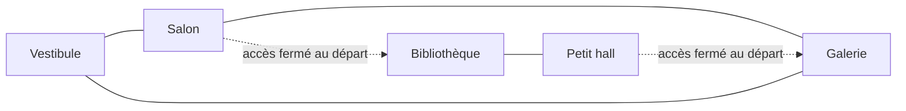
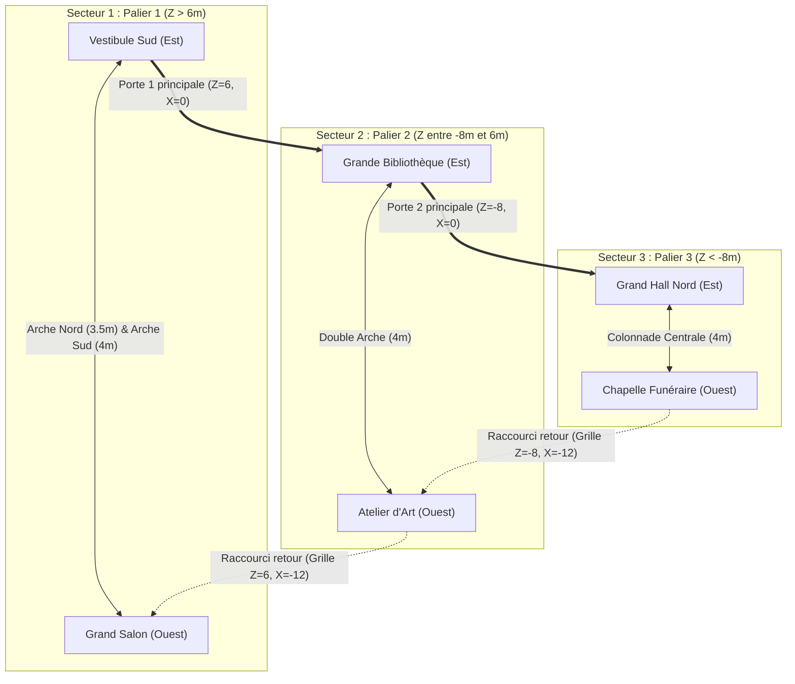
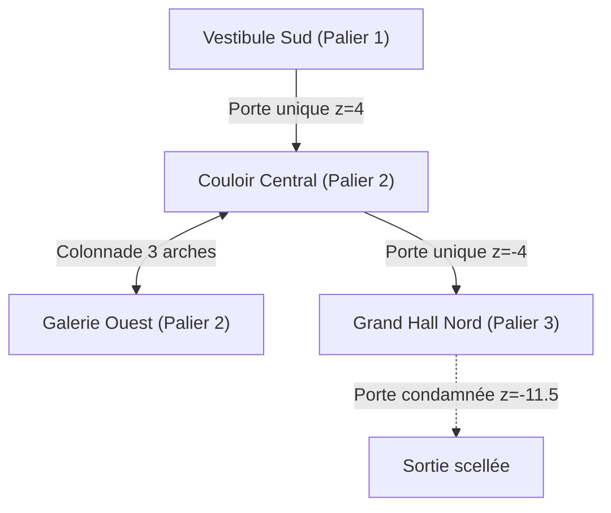

# Manoir-arène — plan de circulation proposé

Mise à jour du 2 novembre 2026. La direction « même manoir ouvert progressivement » est validée ; les noms, connexions et dimensions ci-dessous sont une proposition à essayer en volumes simples. Aucun changement de carte n'est implémenté par ce document.

L'ancien trajet linéaire et son extraction sont archivés dans archives/PLAN_NIVEAU_LINEAIRE_2026-11-01.md.

## Secteur initial : un circuit

Les traits pleins du secteur initial représentent des passages praticables. Les deux accès vers l'aile Bibliothèque/Petit hall s'ouvriraient après un premier palier ; l'ouverture crée alors un deuxième itinéraire entre Salon et Galerie. Les deux salles de l'aile ne sont pas accessibles au départ malgré leur liaison interne.

Le dessin indique des connexions, pas une disposition métrique ni des couloirs obligatoirement rectilignes.

## Rôle des espaces

- Vestibule : repère reconnaissable et zone assez ouverte pour apprendre les commandes.
- Salon : arène de combat avec une couverture contournable, sans piège permanent autour du joueur.
- Galerie : liaison plus étroite qui change le rythme, mais assez large pour une circulation lisible.
- Bibliothèque/Petit hall : extension apportant un détour et une autre possibilité de combat, plutôt qu'une impasse plus longue.

Rester prudent avec les angles, goulots et portes : un zombie incapable de rejoindre le joueur peut empêcher de terminer tout un palier. Valider les chemins du groupe dans le secteur initial avant de multiplier les ailes.

## Règles d'ouverture proposées

1. Le joueur apprend d'abord le circuit initial.
2. Un palier est terminé, puis le joueur choisit une récompense gratuite.
3. La transition ouvre les deux accès de l'aile et signale ce qui est devenu accessible.
4. Le groupe suivant utilise uniquement des emplacements praticables du secteur désormais ouvert.
5. Les anciennes zones restent accessibles ; les accès ne se referment pas au milieu d'une tentative.

Ne pas faire apparaître d'ennemi derrière un accès fermé. Pas de génération procédurale ni de changement de carte dans le premier prototype.

## Validation en volumes simples

- Faire le tour du circuit dans les deux sens sans combat.
- Vérifier que chaque ouverture et chaque porte laisse passer joueur et ennemis.
- Faire poursuivre le joueur autour de chaque boucle, sans mur traversé ni blocage permanent.
- Vérifier les possibilités de repli sans rendre le couloir unique obligatoire.
- Ouvrir l'aile et confirmer qu'elle crée un choix de trajet.
- Recommencer une tentative : les accès supplémentaires doivent revenir à leur état initial.
- Ajouter ensuite les repères du manoir et l'éclairage ; conserver la lisibilité des passages.

Les dimensions exactes, la largeur des passages et la place des couvertures se règlent après essai. Le plan actuel de deux salles et un couloir est une base technique, pas encore ce manoir-arène.

---

## Circuit implémenté (Mise à jour — 2 novembre 2026 : Arène 48×40m)

Le manoir s'étend désormais sur une enveloppe spacieuse de **48 × 40 mètres**, composée de **6 grandes salles** interconnectées en circuits fluides avec passages libres $\ge 3.5$ m :

### 1. Structure des 3 Secteurs

### 2. Règles de circulation et déverrouillage
- **Palier 1 (Immédiat)** : Boucle fermée Vestibule $\leftrightarrow$ Grand Salon. Les portes vers le nord sont fermées (ligne $Z = 6$ hermétique).
- **Palier 2** : Déverrouillage de la Porte 1 principale (Bibliothèque) et de la grille retour de l'Atelier. Circuit en « 8 » sur 4 grandes salles.
- **Palier 3** : Déverrouillage de la Porte 2 principale (Grand Hall) et de la grille retour de la Chapelle. Circuit périmétrique complet sur tout le manoir.
- **Sortie finale** : Porte monumentale au fond du Grand Hall ($Z = -19.5$) définitivement condamnée. Purgatoire complet du manoir pour la victoire.
- **Couloir Central & Galerie Ouest** ($x \in [-11.5, 2.5], z \in [-4, 4]$) : zone ouverte pour le Palier 2. Le mur séparateur à $x = -2.5$ est percé d'une colonnade à trois ouvertures (arches nord, centre et sud), offrant une boucle de contournement (*kiting*) continue à 360°.
- **Porte unique du Palier 2** ($x = 0, z = -4$) : ouvre l'accès vers le Grand Hall Nord.
- **Grand Hall Nord** ($z \in [-11.5, -4.5]$) : arène finale du Palier 3.
- **Porte de sortie condamnée** ($x = 0, z = -11.5$) : limite physique permanente.

Cette topologie permet le contournement tactique (*kiting*) complet et supprime les impasses fatales.
